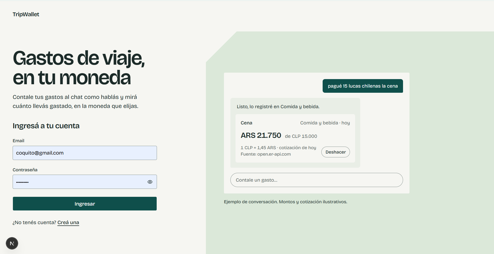

# TripWallet

Copiloto de gastos de viaje multimoneda con IA. Le contás tus gastos como hablás ("pagué 15 lucas chilenas la cena"), los convierte a la moneda de tu viaje y te dice cómo venís contra el presupuesto.

- **App en producción:** https://tripwallet-sofia.vercel.app
- **Cuenta demo** (con viajes y gastos cargados): `coquito@gmail.com` / `Argentina2`

## Definición del producto

- **Problema:** al viajar, los gastos se mezclan en varias monedas y medios de pago, se pierde la cuenta de cuánto se lleva gastado y las apps de gastos obligan a completar formularios.
- **Público:** personas de Argentina y la región que viajan solas o en pareja, sobre todo al exterior, y quieren controlar sus gastos sin planillas.
- **Propuesta de valor:** registrás gastos como hablás, los ves al instante en tu moneda y consultás cómo vas sin sacar cuentas.

## Qué se puede hacer

| User story | Estado |
| --- | --- |
| **US1** Cuenta personal: registro, ingreso y cierre de sesión con email y contraseña; cada persona ve solo sus datos (RLS) | Hecha |
| **US2** Crear un viaje con nombre, destino, moneda base (buscador de monedas), fechas y presupuesto opcional | Hecha |
| **US3** Chat con historial guardado, streaming, cancelar respuesta, reintentar si falla y contador de caracteres | Hecha |
| **US4** Registrar un gasto en lenguaje natural: el bot extrae los datos, pregunta si algo es ambiguo, convierte la moneda y muestra una tarjeta con opción de deshacer | Hecha |
| **US5** Consultar gastos por categoría, por día o total, y cómo voy contra el presupuesto, con totales calculados por código | Hecha |
| **US6** Calificar las respuestas del bot con pulgar arriba o abajo: la calificación se guarda, se puede cambiar y se ve al volver a entrar | Hecha |
| **US7** Panel de debug: un interruptor "Modo debug" muestra, bajo cada respuesta del bot, las tools que llamó (con parámetros y resultado), el modelo y los tokens consumidos | Hecha |
| **US8** Cerrar un viaje y ver su resumen: se calculan y guardan total, categorías, promedio por día y gastos más grandes, se compara lo planificado contra lo real, se guardan las cotizaciones del cierre y el bot redacta un resumen breve; el viaje queda en solo lectura y se puede reabrir | Hecha |

Cosas que conviene probar en el chat:

- `Pagué 15 lucas chilenas la cena` (convierte a la moneda base y cita cotización y fuente).
- `Gasté 3000 pesos en el taxi` (es ambiguo: pregunta qué pesos, con botones).
- `¿Cuánto llevo gastado en comida?`, `¿Y ayer?`, `¿Cuánto me queda del presupuesto?`.
- `Compré un souvenir por 20 dólares` (si no hay una categoría que encaje, propone crear una y espera tu confirmación).
- `Cerrá el viaje` (pide confirmación con botones, cierra el viaje y muestra el resumen). También se puede cerrar y reabrir con el botón de la barra del viaje.
- Tocar el pulgar arriba o abajo debajo de una respuesta del bot para calificarla.
- Activar "Modo debug" (en la barra del viaje) para ver qué tools usó el bot y cuántos tokens gastó en cada respuesta.

### Extras implementados

- Streaming de las respuestas.
- Sistema de feedback: pulgar arriba o abajo en cada respuesta del bot (US6).
- Panel de debug con las tools llamadas, sus parámetros y resultados, y los tokens por respuesta (US7).
- Salida estructurada: el resumen del viaje se pide al modelo con un esquema de Zod (titular y puntos) y se valida antes de guardarlo (US8).
- Límite de 30 mensajes por hora por usuario.
- Tests con Vitest (más de 700, sobre servicios, validaciones, tools y flujo del chat).
- Tool calling nativo y few-shot en los prompts.
- Accesibilidad: etiquetas ARIA, `aria-live` en el chat, navegación por teclado, foco visible y secciones minimizables con `<details>` nativo.
- Cada mensaje del bot guarda las tools que llamó, el modelo y los tokens usados.

## Interfaz

- **Pantalla del viaje:** una barra fija arriba (volver, título y fechas, modo debug y cerrar o reabrir el viaje) y el chat con scroll propio, así que el cuadro de texto y las acciones siempre quedan a mano.
- **Panel de estadísticas** (en escritorio, a la derecha del chat): lo gastado, cuánto queda del presupuesto, el promedio por día, la dona de gastos por categoría y los últimos gastos. Se actualiza solo cuando el bot registra o borra un gasto, o al tocar "Deshacer". "Gastos por categoría", "Últimos gastos" y, con el viaje cerrado, el "Resumen del viaje" se pueden minimizar.
- **En celular** se ve solo el chat; el botón "Estadísticas" de la barra abre el mismo panel como hoja a pantalla completa.
- **Mis viajes:** tarjetas con el estado del viaje (en curso, próximo, sin cerrar o cerrado), en qué día va o cuánto falta, y orden por situación.

## Capturas

Las imágenes están en `docs/img/`.

| Pantalla | Captura |
| --- | --- |
| Ingreso |  |
| Ingreso con la cuenta demo |  |
| Mis viajes |  |
| Nuevo viaje |  |
| Viaje: chat y panel de estadísticas |  |
| Panel: más estadísticas y últimos gastos |  |
| Modo debug |  |
| Resumen de un viaje cerrado |  |
| Resumen de un viaje cerrado: más detalle |  |

## Arquitectura

Monolito web en capas, con Next.js 16 (App Router) y TypeScript.

```
src/
├── app/            páginas (Server Components) y route handlers (api/**/route.ts)
├── componentes/    componentes de React
├── servicios/      lógica de negocio
├── repositorios/   acceso a datos con supabase-js
├── integraciones/  API de cotizaciones y cliente del modelo
├── ia/             prompt del sistema, few-shot y definición de las tools
├── validaciones/   schemas de Zod
├── errores/        errores propios
└── tipos/          tipos generados de Supabase y compartidos
supabase/migrations/  SQL versionado
```

Las dependencias van en un solo sentido: `app → servicios → repositorios / integraciones`.

Decisiones principales:

- **Los números los calcula el código, no el modelo.** Totales, conversiones y porcentajes se calculan en TypeScript (sumas en centavos enteros para evitar errores de coma flotante). El modelo solo interpreta el pedido y redacta la respuesta.
- **Las tools del modelo llaman a servicios** y no tienen lógica propia. El `viaje_id` lo inyecta siempre el servidor; el modelo nunca lo elige.
- **Todo se valida con Zod en el servidor:** entradas, argumentos de las tools, respuestas de la API de cotizaciones y resultados guardados.
- **Seguridad en la base:** RLS en todas las tablas, y `supabase-js` siempre corre con la sesión de la persona. La clave secreta de Supabase no se usa. La sesión viaja en cookies `httpOnly` y el navegador nunca habla directo con Supabase.
- **Cotizaciones:** [open.er-api.com](https://open.er-api.com) con timeout, reintentos con backoff, caché diaria en la base y, si la API falla, última cotización guardada con aviso. Si no hay ninguna, no se guarda el gasto.
- **Historial en el servidor:** el modelo recibe los últimos 20 mensajes más el contexto del viaje (moneda base, presupuesto, categorías, fecha de hoy y zona horaria). El servidor guarda cada mensaje antes de llamar al modelo.
- **Panel de estadísticas:** los números salen de `servicios/panelViaje.ts` (funciones puras con tests, sobre los mismos cálculos de la consulta del chat) y la página los arma en el servidor. Cuando el bot registra o borra un gasto, el chat pide la página de nuevo con `router.refresh()`: el navegador nunca calcula ni consulta la base. Los gráficos (la dona y las barras) son SVG y CSS propios, sin librería, y el dato siempre está también escrito.
- **Gastos de viajes cerrados:** un trigger en la base los bloquea, además de la validación en los servicios.
- **Cierre de viaje:** las estadísticas las calcula el código (reutilizando los cálculos de la consulta del chat) y el modelo solo redacta el resumen. Cerrar es una transacción de Postgres (`cerrar_viaje`) que comprueba que los gastos usados sigan siendo todos los del viaje: si cambiaron mientras se armaba el resumen, se recalcula y se reintenta hasta 3 veces. El resumen del modelo tiene un límite de 20 segundos y, si falla, el viaje se cierra igual sin texto. Sin cotizaciones (ni de hoy ni guardadas) no se cierra.

Tools del bot: `registrar_gasto`, `consultar_gastos`, `convertir_moneda`, `eliminar_gasto`, `crear_categoria`, `cerrar_viaje` y `pedir_datos`.

### Por qué estas tools y esta API

- **La API externa es una de cotizaciones** porque el problema del producto es la multimoneda: sin una cotización del día no se puede convertir un gasto ni comparar contra el presupuesto. `open.er-api.com` es gratuita y no requiere clave.
- **Tool A (API externa):** `convertir_moneda` y `registrar_gasto` usan las cotizaciones. **Tool B (acción interna):** `registrar_gasto`, `consultar_gastos`, `eliminar_gasto` y `crear_categoria` guardan, leen y calculan estadísticas sobre la base.
- **El modelo decide cuándo usar cada una** según lo que cuente la persona: un gasto, una consulta, una conversión suelta o una pregunta de aclaración.
- **`pedir_datos` existe para no adivinar:** si falta o es ambiguo un dato que se elige entre opciones (por ejemplo qué "pesos"), el bot pregunta con botones en vez de guardar algo incorrecto. Los datos libres (descripción, monto) se preguntan escribiendo.

### Cómo se estructuran los prompts

- **Prompt del sistema armado por código** en cada mensaje: datos del viaje (moneda base, presupuesto, categorías), la fecha de hoy en la zona horaria de la persona y reglas separadas por tema (registrar gastos, consultar, formato de las respuestas).
- **Few-shot:** ejemplos concretos ("15 lucas chilenas", "taxi 8k", "pesos" ambiguos, consultas por categoría y por día) para fijar cómo interpretar montos, monedas y fechas.
- **Salida estructurada:** cada tool tiene un schema de Zod; los argumentos que manda el modelo se validan antes de ejecutar nada.
- **El modelo recibe los números ya calculados y formateados** (por ejemplo en `consultar_gastos`) y tiene la instrucción de no sumar ni calcular porcentajes.

### Manejo de errores

- **Errores propios en los servicios** (validación, no encontrado, viaje cerrado, cotización no disponible) que los route handlers traducen a HTTP (400, 404, 409, 503) con un formato único: `{ "error": { "codigo": "...", "mensaje": "..." } }`. Los errores inesperados se registran con detalle en el servidor y la persona ve un mensaje genérico.
- **Las tools no lanzan excepciones:** devuelven un resultado que describe la falla (`ok: false`, código y mensaje) para que el bot la explique con sus palabras y no diga que guardó algo que no guardó.
- **API de cotizaciones:** timeout de 5 segundos, hasta 2 reintentos con espera creciente ante errores 5xx o límite de pedidos, validación de la respuesta con Zod y caché diaria; si todo falla se usa la última cotización guardada, avisando, y si no hay ninguna no se guarda el gasto.
- **En el chat:** si algo falla se muestra la causa y un botón para reintentar; los estados de carga y error se anuncian a lectores de pantalla.

## Correrlo en local

Requisitos: Node 22 o superior, una cuenta de Supabase, una API key de OpenAI.

```bash
npm install
cp .env.example .env.local
```

Completá `.env.local`:

| Variable | Para qué |
| --- | --- |
| `OPENAI_API_KEY` | Key de OpenAI (la usa solo el servidor) |
| `OPENAI_MODELO` | Opcional. Modelo del chat; por defecto `gpt-5.4-mini-2026-03-17` |
| `NEXT_PUBLIC_SUPABASE_URL` | URL del proyecto de Supabase |
| `NEXT_PUBLIC_SUPABASE_PUBLISHABLE_KEY` | Clave publicable de Supabase |

Aplicá las migraciones a tu proyecto de Supabase y levantá la app:

```bash
npx supabase link --project-ref <ref-de-tu-proyecto>
npx supabase db push
npm run dev
```

Se abre en http://localhost:3000. En Supabase, desactivá la confirmación de email (Authentication → Providers → Email) para poder registrarte sin confirmar.

Scripts: `npm run dev`, `npm run build`, `npm run lint`, `npm run test`, `npm run test:watch`.

## Limitaciones conocidas

- Una persona que llame directo a la API de Supabase con su propia sesión podría guardar mensajes con rol de asistente o un `monto_convertido` inventado. Solo afecta sus propios datos (RLS); bloquearlo exigiría escribir con la clave secreta, que se descartó a propósito.
- El límite de 30 mensajes por hora no es transaccional: dos pedidos exactamente simultáneos pueden pasarlo por uno o dos mensajes.
- Si se cancela una respuesta, lo que el bot alcanzó a escribir se guarda al cerrarse el stream; en un despliegue serverless podría no completarse si la función se corta al desconectarse el navegador.
- Por chat solo se puede eliminar el último gasto cargado, y el viaje se cierra pero no se reabre (eso se hace con el botón de la pantalla).
- Cerrar el viaje desde el chat pide confirmación por instrucción del prompt, no por código: es reversible (se puede reabrir), así que se consideró suficiente.
- Al reabrir un viaje se borra su resumen y al volver a cerrarlo se genera uno nuevo (así nunca queda desactualizado). El texto del resumen no se puede reintentar sin reabrir.
- El promedio por día se calcula sobre los días del viaje (de inicio a fin), no sobre los días con gastos. Con el viaje abierto, el panel promedia sobre los días que ya pasaron.
- La fecha de "hoy" de la lista de viajes y del panel se toma en UTC en el servidor: cerca de la medianoche puede diferir un día de la zona horaria de la persona.
- Los montos se guardan con 2 decimales: monedas con 3 (por ejemplo el dinar kuwaití) pierden el último.
- Las respuestas del bot se muestran como texto plano, sin Markdown.
- El registro avisa si un email ya tiene cuenta (sin confirmación de email es inevitable; se priorizó un mensaje útil).

## Ideas futuras

Estas dos historias no llegaron a implementarse. Parte de la base ya está lista: la tabla `presupuestos_viaje` existe y el cierre de viaje ya la lee (con presupuesto por categoría, el resumen compararía lo planificado contra lo real categoría por categoría), y al cerrar un viaje ya se guarda la foto de las cotizaciones del día, que es lo que necesita la comparación entre viajes.

### US9 — Estimar el presupuesto antes de viajar

Como viajero que está planificando un viaje, quiero que el bot me haga algunas preguntas y me arme un presupuesto estimado por categoría, para saber cuánta plata llevar y después controlar si me ajusto a lo planeado.

- El bot pregunta solo lo que no sabe (personas, auto, cocina o comidas afuera, nivel de gasto, actividades, compras), con opciones para tocar.
- Aclara que no incluye vuelo ni hospedaje y que es una estimación orientativa.
- Cada categoría muestra el monto y los supuestos; los totales los calcula el sistema a partir de costos diarios.
- Se estima en la moneda del destino y se muestra en la moneda base con la cotización usada.
- Puedo editar los montos antes de aceptar; al aceptar queda como presupuesto por categoría del viaje.

### US10 — Comparar viajes

Como viajero, quiero comparar mis viajes cerrados en la moneda que elija, para saber en cuál gasté más y planificar mejor el próximo.

- Puedo elegir la moneda de comparación.
- Las conversiones usan la cotización del día de cierre de cada viaje (ya guardada al cerrar).
- La comparación muestra el gasto promedio por día, además del total.
- Si no tengo al menos dos viajes cerrados, veo un mensaje que lo explica.

### Otras ideas

- Tests end-to-end con Cypress.
- Mapa del destino en el panel del viaje y un gráfico con todos los viajes (requiere geocodificar el destino y, para comparar gastos, convertir monedas como en la US10).
- Reintentar solo el resumen del modelo de un viaje cerrado, sin reabrirlo.
